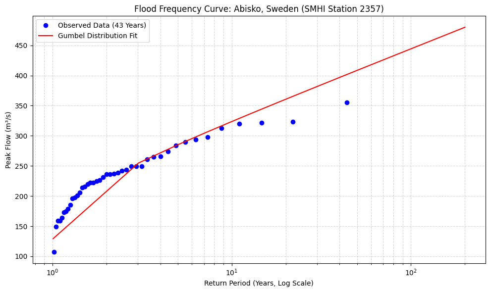

# Swedish-River-Flood-Risk-Capstone
# Automated Flood Frequency Analysis: Abisko, Sweden

## 📌 Project Overview
This repository contains a complete, end-to-end Python pipeline for performing Extreme Value Analysis (Flood Frequency Analysis) on historical river discharge data. It automates the retrieval of live data from the Swedish Meteorological and Hydrological Institute (SMHI), processes the raw data, and predicts extreme flood events (e.g the 100-year flood) for infrastructure design.

## 🛠️ Technical Stack
*   **Data Acquisition:** `requests`
*   **Data Processing:** `pandas`, `numpy`
*   **Statistical Modeling:** `scipy.stats` (Gumbel distribution)
*   **Visualization:** `matplotlib`

## ⚙️ Methodology
1.  **Data Retrieval:** Queries the SMHI Hydrological Observations API for daily streamflow data at Station 2357 (Abisko).
2.  **Data Cleaning:** Handles missing values, non-standard delimiters, and formatting quirks in the raw CSV.
3.  **Annual Maximum Series (AMS):** Extracts the peak flow event for every year on record (43 years).
4.  **Extreme Value Analysis:** Fits a Gumbel distribution to the AMS to model the probability of extreme events.
5.  **Prediction:** Calculates the predicted peak flows for 10-year, 50-year, and 100-year return periods.
6.  **Visualization:** Generates a semi-logarithmic Flood Frequency Curve.

## 📊 Results
Based on 43 years of observed data:
*   **10-Year Flood:** 323.6 m³/s
*   **50-Year Flood:** 408.4 m³/s
*   **100-Year Flood:** 444.3 m³/s

